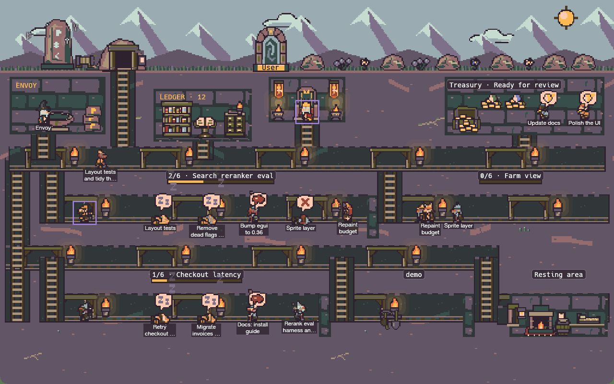

# Stronghold

Stronghold is Karl's macOS desktop dashboard for his agent clan in the Orca agent IDE.
It turns agent sessions into dwarves in a live pixel-art hold, so you can see who is
working, idle, waiting for input, stalled or done without checking every terminal.
The King chat helps coordinate the clan, the whip nudges stalled agents, and the
review queue keeps finished PRs in sight. It exists to make a busy clan easier to
follow—and easier to help when someone gets stuck.



*Eight seconds of synthetic demo agents, using Resurrect 64 and native “Hold pixels”.*
[Watch or download the MP4](docs/images/stronghold-demo.mp4) ·
[Still image](docs/images/stronghold-demo.png)

## What you can do

- **Watch the clan.** See coordinators, workers and subagents in the hold. Select a
  dwarf to read its terminal and send input; filter by repo or run to find your work.
- **Keep work moving.** The whip spots stalls, nudges agents and escalates when they
  need you. It starts in dry-run mode so you can inspect its decisions first.
- **Talk to the King.** Use the built-in chat to inspect the clan, start dwarves and
  coordinate work. Agents can send updates and blockers to the King's inbox.
- **Review finished work.** The review queue collects PRs agents mark ready and
  shows their GitHub status.
- **Stay in touch through the Envoy.** An optional Slack liaison routes messages
  between people and agents, with an approval queue for outgoing messages.
- **Share context.** Search and read the Ledger, load role instructions from the
  playbook, or use Stronghold's MCP tools from your own agent chat.

## How it works

**Orca runs the agents.** Stronghold reads Orca's runs and terminals through the
`orca` CLI and watches Claude session transcripts for additional state. The hold
is a view of that work; selecting a dwarf connects you to its existing terminal.

**MCP connects your chats.** The `stronghold mcp` stdio server exposes clan status
and controls to Claude Code, Codex and other MCP clients. Live dashboard tools
connect to the running app through a local Unix socket. See the
[MCP reference](docs/mcp.md) and [control API](docs/control-api.md).

**The playbook gives the clan shared rules.** Markdown files in
[`playbook/`](playbook/README.md) describe coordinator, worker, attendant, Envoy
and Lorekeeper roles. Stronghold serves them directly from disk through MCP and the CLI, even
when the dashboard is closed.

## Quick start

With Orca, Rust/Cargo 1.95 or newer, Apple's command line tools, Python 3 and `just`
installed, run this from the repository root:

```bash
just install
```

Open **Stronghold** from `~/Applications`, keep Orca running, and select a dwarf.
After installing an update, quit and reopen Stronghold to use the new build.

See **[SETUP.md](SETUP.md)** for prerequisites, first launch, Claude Code and Codex
MCP connections, configuration and troubleshooting.
