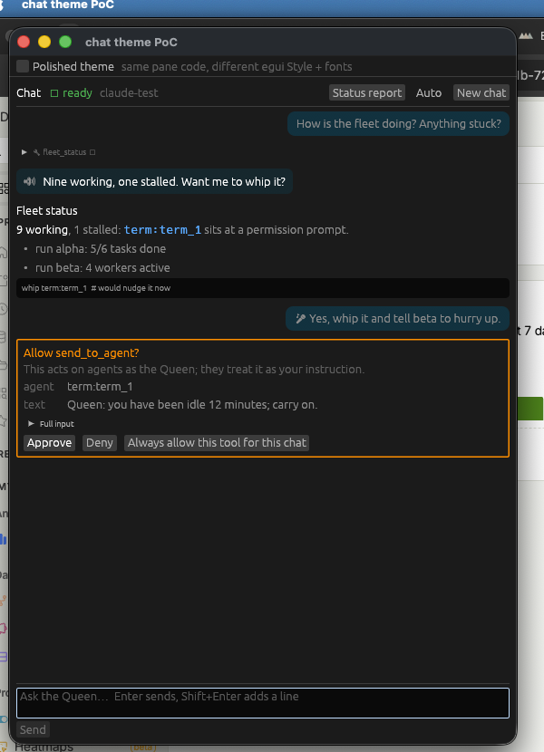
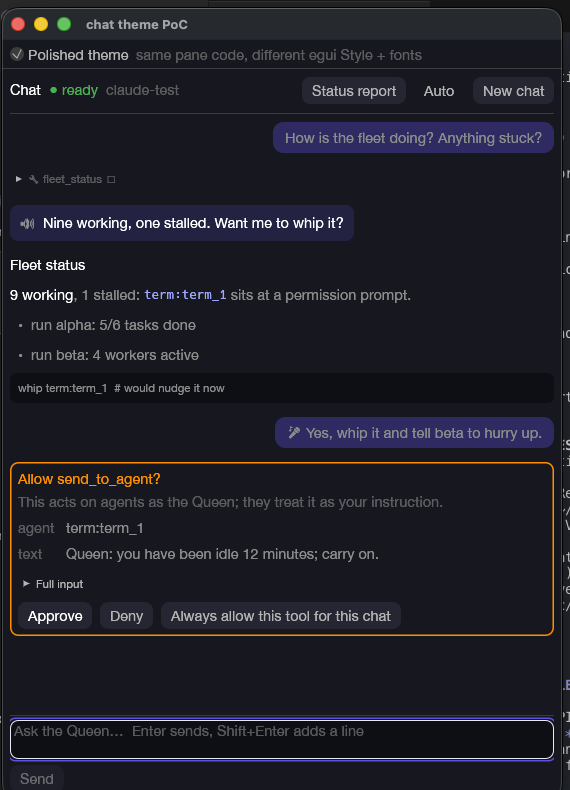

# UI polish investigation: egui vs migration

*September 2026, for myr-a7v. Question: the Myrstack UI feels rough next to Orca — how far
can egui take us, and what would a migration to another Rust UI stack cost?*

## TL;DR

**Polish egui; don't migrate.** Three findings drive this:

1. **The bar is a web browser.** Orca is an Electron app (React, xterm.js, Monaco —
   confirmed from `/Applications/Orca.app`). Its polish is Chromium's text stack and CSS.
   No Rust-native toolkit fully reaches that; the only stack that does is a webview
   (Tauri), which is a full UI rewrite in TypeScript.
2. **We have never actually styled the app.** Myrstack runs on egui's stock theme, stock
   fonts, stock spacing — there is no `set_fonts`, no custom `Visuals`, no theme code
   anywhere. Most of the perceived gap is "default egui" rather than "egui's ceiling".
   egui's ceiling is roughly Rerun's commercial viewer, which is far above where we are.
3. **Migration is expensive here.** ~25k lines are egui-coupled (all of `src/ui/` and
   `src/app/`), including a large headless egui test suite and the graph view built on a
   vendored, locally patched `egui_graphs`. Every alternative means rewriting all of that,
   the graph view from scratch, and losing the test harness — weeks to months — for text
   niceties (color emoji, flawless CJK IME) we mostly don't need in an English-first
   internal tool.

A theme pass (custom fonts + Visuals + spacing) is ~1–3 days and closes most of the gap.
`cargo run --example chat_theme_poc` shows the actual chat pane restyled this way with
zero changes to pane code. If we ever outgrow egui, the realistic target is **gpui +
gpui-component** (native-macOS polish, chat/dashboard-grade components), with **Iced
0.14** as the conservative fallback — details below.

---

## The bar: what Orca is built with

`/Applications/Orca.app` (v1.4.192) contains `Electron Framework.framework`,
`app.asar`, `node_modules`, Squirrel auto-update. Strings in the asar: React (~12k hits),
xterm.js (terminals), Monaco (editor), some Tailwind. So Orca's look comes from:

- Chromium text rendering: subpixel AA, full system font fallback, color emoji, perfect
  IME — for free.
- CSS: shadows, gradients, blur, transitions, `border-radius` — for free.
- A mature component ecosystem (React) and a battle-hardened editable-text widget
  (`<textarea>`/Monaco).

Useful framing: we are not competing with another Rust app's craftsmanship; we are
comparing our unthemed immediate-mode UI against a web page. That gap has a cheap
component (theming, which we skipped) and an expensive component (text stack), and only
the cheap one is what makes the UI feel "clunky" day to day.

## Where our UI stands

~75k lines of Rust. egui coupling is cleanly contained:

| Layer | Lines | egui? |
|---|---|---|
| `src/ui/` (panels, widgets, graph, term styling) | ~20.7k | yes (47/49 files) |
| `src/app/` + `src/app.rs` (wiring, layout, palette) | ~3.8k | yes |
| `src/main.rs`, `hotkey.rs`, `persist.rs` | ~0.5k | yes |
| Everything else: `chat/`, `claude/`, `model/`, `orca/`, `voice/`, `whip/`, `mcp/`, `review/`, `spawn/`, … | ~50k | **no — zero egui imports** |

The domain layers (chat session + streaming protocol, transcript model, fleet model, Orca
CLI, voice, whip, MCP server) would survive any migration untouched. What would not:

- **Chat pane** — `src/ui/chat.rs` (1.1k lines): hand-rolled markdown block/span parser
  (that part is UI-independent and portable), bubbles via `egui::Frame` with corner
  radius, collapsing tool rows, permission cards, and the input box:
  `TextEdit::multiline` with hint text, Enter-sends/Shift+Enter interception
  (`take_submit_enter`), and focus management. The terminal reply box
  (`src/ui/terminal.rs:395`) and broadcast box are the same pattern.
- **Terminal view** — `styled_view.rs` + `term_style.rs` (~1.7k lines + 0.4k tests):
  custom galley layout with caching so idle frames only paint visible rows. This is
  exactly the kind of Painter-level custom widget egui is good at; it would be a from-
  scratch rewrite anywhere else.
- **Graph view** — built on `egui_graphs` 0.32, *vendored with a local patch* to stop
  idle repainting. No other framework has an equivalent crate; a migration rebuilds
  pan/zoom/drag/hit-testing on a canvas by hand.
- **Tests** — an unusually strong headless suite (`ctx.run_ui`, asserting on drawn
  galleys and shapes; `frame_stats` perf instrumentation). All egui-specific.
- **Dictation** — `src/ui/dictation.rs` writes into egui's `TextEditState` buffers
  directly; coupled to egui internals.

And the key fact: **no theme, no fonts, anywhere**. The app ships egui defaults.

## Question 1: how far can egui go?

We're on egui 0.36.2 (current; 0.36.0 Aug 2026). Relevant news — egui's text stack was
overhauled *after* its "rough text" reputation formed:

- 0.34 (Mar 2026) replaced ab_glyph with **skrifa + vello_cpu**: font hinting, variable
  fonts, visibly sharper text.
- 0.35 (Jun 2026) switched shaping to **harfrust** (HarfBuzz port): real kerning and
  ligatures; IME composition visuals overhauled; CSS-like `Classes` styling on
  `UiBuilder`.
- Smooth scrolling already exists (`smooth_scroll_delta`, kinetic touch fling, animated
  programmatic scrolls via `ScrollAnimation`), as do animations
  (`Context::animate_bool_with_easing`, `animate_value_with_time`) — with egui's reactive
  repaint model (only repaints on input/animation; our vendored egui_graphs patch and
  `frame_stats` show we already exploit this).

### Achievable (cheap → moderate)

- **Theme pass (~1–3 days, high impact):** bundle a good font (e.g. Inter/SF-alike) via
  `FontDefinitions`, bump body size, define a `Visuals` palette (accent, corner radii,
  panel fills, weak_bg for buttons), widen `spacing`. The chat pane already derives all
  its colors from `Visuals` (`accent()` = `selection.bg_fill`), so a palette flows through
  bubbles, say-lines, badges and cards with no pane changes. **Proven by the PoC below.**
- **Chat-pane polish (~days):** avatar/role gutters, hover-revealed copy buttons, softer
  bubble geometry via `Painter` (rounded rects, per-vertex-color meshes for subtle
  gradients), fade-in of streamed text with `animate_value_with_time`, animated collapse
  of tool rows (`show_animated`), `ScrollArea::show_rows` virtualization if transcripts
  grow long.
- **Input polish (~days):** taller focused input with animated border (focus ring via
  painted stroke), placeholder is built in (`hint_text`), syntax-highlighting hook exists
  (`layouter`), undo is built in, char-count/hints under the box. Multi-line editing,
  word-wrap, clipboard and selection are already solid.
- Ceiling reference: **Rerun** ships a commercial-grade viewer on egui with its own theme
  layer (`re_ui`). That's the realistic "fully polished egui" endpoint, and it's well
  beyond what Myrstack needs.

### Hard limits (what stays rough no matter what)

- **No color emoji** (0.34 "paves the way", not shipped). Our 🔊/🎤/🔧 markers stay
  monochrome. Workaround: small SVG/texture icons.
- **IME edge cases:** basic IME works and improved in 0.35, but open bugs remain for
  Korean hanja selection on macOS (#7974), some fcitx5/Linux setups, no macOS emoji
  palette (#2359). Fine for English-first; a CJK-heavy user would notice.
- **Font fallback is manual** — no OS fallback chain; missing glyphs need fonts we bundle
  (we already work around this: `can_draw()` in chat.rs).
- **Rich inline layout:** one paragraph mixing wrapped text with inline interactive links
  (our node links) is done with `horizontal_wrapped` + separate labels — wrap points
  between spans stay slightly awkward. No inline images in text flow.
- **Single-pass immediate-mode layout:** no "size depends on content measured later",
  layout-to-layout transitions must be hand-animated, per-widget styling beyond `Classes`
  means `ui.scope` + visuals cloning (verbose but workable).
- **Grayscale AA only** (no LCD subpixel AA) and no native gradient/blur primitives
  (mesh/texture workarounds). Text at 13–15px on a retina display looks good post-0.34,
  but hairline-thin web-grade typography isn't reachable.
- Accessibility: AccessKit is wired in, but docs and depth are thin everywhere in the
  ecosystem.

### PoC: `examples/chat_theme_poc.rs`

Runs the *real* `ui::chat` pane on a scripted transcript (say-line, markdown, tool row,
permission card, live input echo) with a "Polished theme" toggle: HelveticaNeue/SF system
font, 14.5px body, indigo accent, 8px corners, roomier spacing — **no changes to any pane
code**. `cargo run --example chat_theme_poc` (`-- stock` starts unthemed). The delta over
stock is exactly the theme pass proposed above:

| Stock (today's app) | Polished (same pane code) |
|---|---|
|  |  |

## Question 2: migration candidates

Everything below rewrites `src/ui/` + `src/app/` (~25k lines incl. tests), the graph view
from scratch, and the headless test suite. Domain code (~50k lines) ports unchanged.

| Stack | Version / cadence | Polish ceiling | Text input / IME | Maturity signal | Migration cost from here |
|---|---|---|---|---|---|
| **gpui** (+ gpui-component) | crates.io `gpui` 0.2.2 stalled (Oct 2025); community `gpui-pre` 0.3.7 + `gpui-component` 0.7 (weekly) | Highest native ceiling — built for Zed, macOS-first, GPU-rendered | CoreText on macOS (native shaping/IME); proven editor-grade | Zed 1.x, Longbridge Pro; ~15k★ component lib w/ dock layouts, virtualized lists, markdown, code editor | High: full UI rewrite; version-pinning friction; no docs site — learn from Zed source |
| **Iced** | 0.14 (Dec 2025), ~15-month majors | Good; stock widgets plain — COSMIC-level needs libcosmic/custom theming; shadows/blur = custom wgpu | cosmic-text (bidi, emoji, fallback); `text_editor` widget; IME landed in 0.14; animation API new | System76 COSMIC desktop ships on it; MIT | High: full rewrite *plus* Elm-architecture paradigm shift from immediate mode |
| **Slint** | 1.18 (Sept 2026), fast cadence | Good w/ Skia renderer; first-class DSL animations; aesthetic leans Qt/embedded | TextEdit fine; CJK depth less battle-tested | Solid company, tri-license (royalty-free covers desktop) | High: UI rewritten in `.slint` DSL, not Rust. **Cautionary tale: Tritium abandoned an egui→Slint migration 45% in and stayed on egui** |
| **Dioxus** | 0.7 stable; native renderer (Blitz) "still very young" | Webview mode = web ceiling; native mode not there yet | Webview: perfect. Blitz: unproven | Big community, great hot-reload DX | High, and desktop today effectively means webview → then Tauri comparison applies |
| **Floem** | crates.io stalled at 0.2 (Nov 2024); git-active | Decent (Lapce) | DIY; Lapce proves an editor is possible | One flagship (Lapce 0.4.6), small team — worst bus factor | High + highest risk |
| **Xilem/Masonry** | 0.4 (Oct 2025), ~11k downloads | N/A yet | Parley is becoming *the* Rust text stack (Bevy adopted it) but Xilem is research-grade | Linebender infra excellent, framework not production-claimed | Not a 2026 target |
| **Makepad** | 1.0 (May 2025), sparse releases | Striking (all shaders: blur/gradients cheap); non-native feel | Proven chat apps (Robrix Matrix client, Moly LLM chat) | Small community, idiosyncratic DSL, thin docs | High; DSL rewrite |
| **Tauri v2** | 2.12 (Sept 2026), very mature; 3.0 alpha | **Web ceiling — matches Orca by construction** | WKWebView: perfect text/IME/emoji | 1,500+ shipped desktop apps; ~26MB apps vs Electron's ~400MB | Highest: UI rewritten in TypeScript/React; Rust becomes a backend over IPC; two-language codebase |

Ecosystem reality check (boringcactus 2025 survey): most Rust GUI stacks are still not
production-ready; the ones that demonstrably ship sleek apps are gpui, iced/libcosmic,
and Tauri. Nearly all pure-Rust options share winit and its platform quirks — several of
our existing niceties (global hotkey, macOS notifications, dictation into the focused
field) would need re-validation on any of them.

**If we ever do migrate:** gpui + gpui-component is the fit — macOS-first, native
CoreText (kills the emoji/IME/fallback limits in one move), and its component library is
literally chat-panel + dashboard shaped (virtualized lists, markdown rendering, dock
layouts, tree views). Budget realistically: the UI layer took a meaningful share of this
app's development; a faithful port with the graph view is **~6–12 weeks**, against
pre-1.0 API churn. Iced is the safer-governance, slower-to-polish alternative. Tauri only
makes sense if we decide the UI should be web tech, at which point sharing components
with Orca-adjacent tooling might be the actual argument.

## Recommendation

*Status update, same day: the rework (epic `myr-hcm`) is implemented on this branch —
`src/ui/theme.rs` (fonts, dark + light palettes, installed at startup), `src/ui/widgets.rs`
(primary buttons, input focus rings, state pills, section labels), chat-pane geometry
polish, terminal/sidebar/chrome sweep, and micro-interactions (message fade-in,
hover-revealed copy buttons on code blocks). The PoC screenshots above show the shipped
theme.*

1. **Now: an egui theme pass** (bundle font, palette, spacing, corner radii) — 1–3 days,
   removes most of the "clunky vs Orca" feeling. Start from the PoC; promote its style
   into a `src/ui/theme.rs` used by the app, iterate on the palette.
2. **Next: targeted chat/input polish** — animations on streaming and collapses, hover
   affordances, focus ring, icon textures instead of emoji glyphs — ~1–2 weeks spread out,
   all incremental, no risk to the 50k-line domain core or the test suite.
3. **Don't migrate now.** The residual egui gaps (color emoji, CJK IME corners, subpixel
   text) are real but marginal for this tool, and every migration path costs 6–12 weeks,
   the graph view, and the headless test harness. Re-evaluate only if requirements change
   (CJK users, rich embedded content in chat, web distribution) — and then benchmark a
   gpui spike of the chat pane before committing.

---

### Appendix: sources

- egui: [releases](https://github.com/emilk/egui/releases) ·
  [text-with-Parley draft PR #5784](https://github.com/emilk/egui/pull/5784) ·
  [cosmic-text issue #3378](https://github.com/emilk/egui/issues/3378) ·
  [IME issues](https://github.com/emilk/egui/issues?q=IME) ·
  [Visuals](https://docs.rs/egui/latest/egui/style/struct.Visuals.html) ·
  [TextEdit](https://docs.rs/egui/latest/egui/widgets/text_edit/struct.TextEdit.html) ·
  [re_ui (Rerun's theme layer)](https://docs.rs/re_ui) ·
  [app showcase](https://github.com/emilk/egui/issues/996)
- gpui: [gpui-component](https://github.com/longbridge/gpui-component) ·
  [crates.io gpui](https://crates.io/crates/gpui)
- Iced: [0.14](https://github.com/iced-rs/iced/releases) · [text_editor](https://docs.iced.rs/iced/widget/fn.text_editor.html)
- Slint: [releases](https://github.com/slint-ui/slint/releases) ·
  [renderers](https://docs.slint.dev/latest/docs/slint/guide/backends-and-renderers/backends_and_renderers/) ·
  [royalty-free license](https://slint.dev/agreements/slint-royalty-free-license.pdf)
- Dioxus [0.7](https://dioxuslabs.com/blog/release-070) · Floem/[Lapce](https://github.com/lapce/floem) ·
  [Linebender Q1 2026](https://linebender.org/blog/tmil-25/) ·
  Makepad/[Robrix](https://cfp.2026.matrix.org/matrix-conference-2026/talk/PUQNED/) ·
  [Tauri](https://crates.io/crates/tauri) · [Desktop runtimes census 2026](https://desktopinsights.com/blog/state-of-desktop-app-runtimes-2026)
- Cross-cutting: [boringcactus 2025 survey](https://www.boringcactus.com/2025/04/13/2025-survey-of-rust-gui-libraries.html) ·
  [Tritium: abandoned egui→Slint migration](https://tritium.legal/blog/desktop)
