# Myrstack art: inventory, Paleccino and asset descriptions

Status: **direction changed on 2026-10-12.** Karl disliked the generated comic art and
dropped cloud generation. **The dwarves are now drawn in code as paper cutouts** (section
0): layered parts tinted from single colours, randomised per agent, animated by rotating
pinned pieces. Local generation (Paleccino) stays an option for the *other* assets: tiles,
props, set pieces. Sections 2b–4 record how we got here; the generated-sprite plans there
are superseded for the dwarves.

Bead: `myr-bov`.

## 0. Current direction: code-drawn paper-cutout dwarves

What Karl asked for:
- simpler and more unique art;
- no GPT/cloud generation;
- animation done in the game rather than baked into frames;
- dwarves built like a character creator, with swappable parts (hair, beard, skin and so
  on) in different colours;
- the dwarves possibly coded entirely, with image generation kept for other assets.

Built (commit 8f7716c, bead `myr-bov.1`):

- **`src/ui/dwarf/cutout.rs`, the piece painter.** A piece is a few polygons that move as
  one part. A `Finish` sets how pieces are drawn. **Ink** is the default: a thin dark
  outline, flat fills, no shadow. **Paper** is the first try: a cream border, drop shadows
  and brass pins. Karl: "how the character is composed and behaves, but it doesn't need to
  look like it's made of paper." Ear-clipping triangulation lets concave
  shapes (beards, boots) fill correctly in egui. Smooth outlines come from a few control
  points (Catmull-Rom), placed by an affine transform. Brass split pins mark the joints.
- **`src/ui/dwarf/mod.rs`, the dwarf.**
  - **Look:** 6 skins, 8 hair and beard colours, 6 tunics, 3 trousers; 5 beards (long,
    forked, bushy, short, braided), 5 hats (helmet, candle helmet, cap, bald, crown, the
    last for kings only) and 3 tools (pickaxe, hammer, shovel); nose size and girth.
    `Look::from_seed` gives every agent a stable dwarf. That is already tens of thousands
    of combinations, and adding a style is one function.
  - **Rig:** back arm, boots, body, head (with beard and hat) and front arm with tool,
    pinned at the neck and shoulder. Each pose sets the arm angles, head tilt, lean,
    squash and stretch, hop, stride and brows.
  - **Actions:** `Still` (idle, done and parked never move), `Study` (thinking: leans in,
    squints, scratches under the hat, a "?" pops), `Mine` (slow wind-up with stretch, a
    fast strike with squash and sparks, wobbly recoil) and `Walk`.
- **`examples/dwarf_lab.rs`:** `cargo run --example dwarf_lab`. Dress one dwarf (beard, hat,
  tool, colour swatches or pickers, nose, girth), pick the action and facing, tune the card
  border and shadow, and watch a seeded crowd at work beside him.

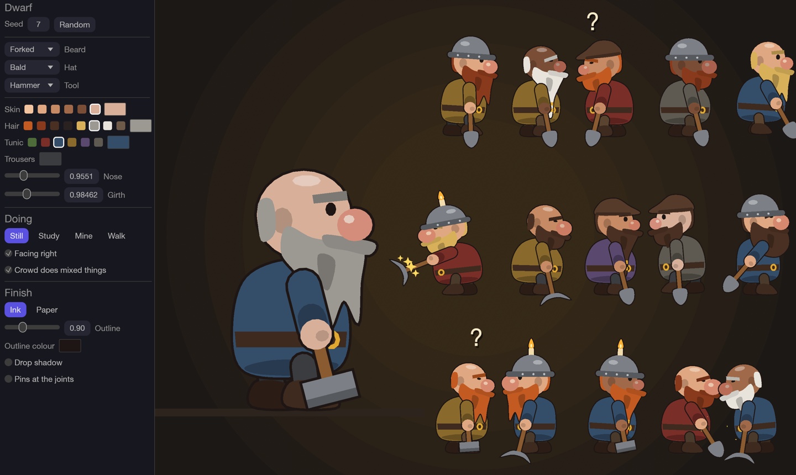
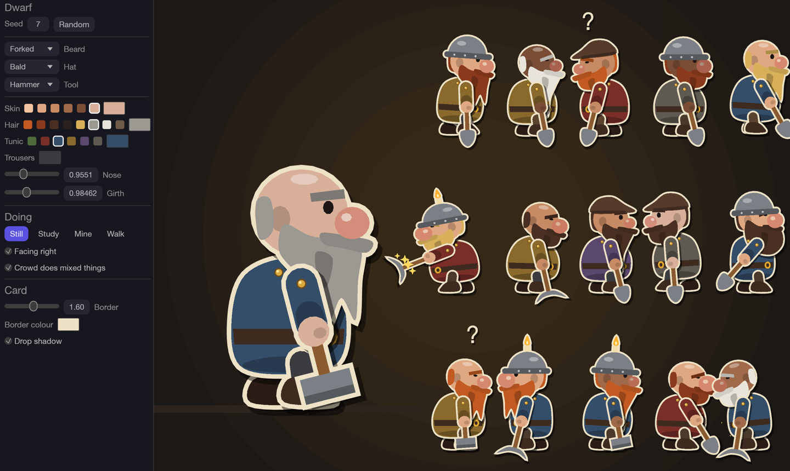
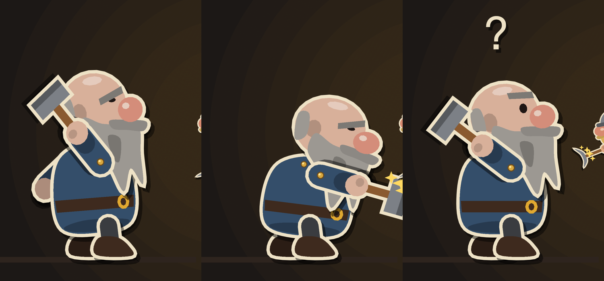

**Pixel experiment** (Karl: "make them low res via a pixelization model and color filter"):

- **`src/ui/dwarf/pixel.rs`:** the dwarf's shapes go through epaint's own tessellator, then
  a small CPU rasteriser at the target size: one sample per pixel by default (hard edges),
  or 4×4 averaged ("blend edges"). Alpha is cut to opaque or transparent. Colours are then
  optionally mapped to a palette, by nearest colour in CIELAB with lightness weighted
  double.
- **`assets/palettes/`:** the 16 Lospec palettes (credited in `assets/LICENSES.md`).
- **The lab's Pixels section:**
  - a pixel-mode switch;
  - dwarf height 16, 24, 32, 40, 48, 64 or 96 px;
  - a palette picker (none or any of the 16);
  - animation frames per second (choppy reads more like pixel art; default 12);
  - a minimum 1 px outline;
  - blended edges;
  - "every palette at once", showing the dressed dwarf, animated, in all 16 palettes plus
    none.

  Run `cargo run --release --example dwarf_lab -- --pixel 48 --palette endesga-32` (or
  `--palettes`). It's an algorithmic filter, not an ML model. It runs live, re-rendering
  only when the animation frame or a setting changes.

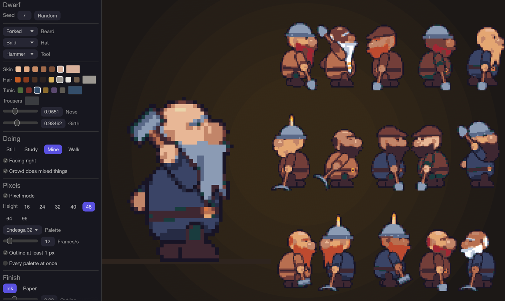
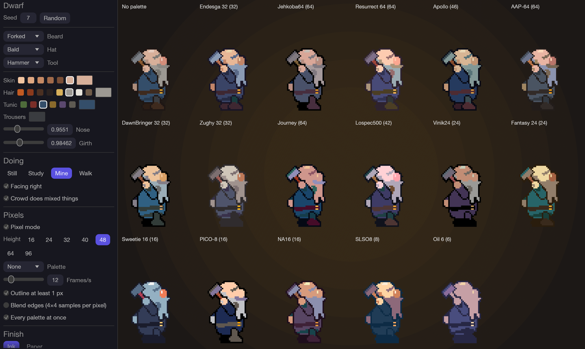

Notes: the outline colour has to stay clear of the background. On the dark mine floor, a
palette's darkest colour can swallow the outline (Oil 6, Fantasy 24). The farm would want a
lighter backdrop, or an outline colour picked per palette.

**In the app** (Karl: "add this pixel and palette options to the app itself"): a new
**Settings → Art** section, saved as the `art` key in `settings.json` and applied at once.

- **"Dwarves instead of ants in the ant farm"** (off by default, so the farm is unchanged
  until it's switched on).
- **Dwarf pixels:** Smooth, Farm pixels (one pixel per farm texel, matching the farm's
  art), or 16, 24, 32, 48 or 64 px tall.
- **Palette:** own colours, or any of the 16 bundled palettes. A palette also works on
  smooth dwarves: their flat shapes are recoloured directly.

How the farm maps onto dwarves (`src/ui/ant_farm/art.rs`):
- The Queen is the King: crown, white braids, red robe, ruby scepter. While her chat turn
  runs he studies.
- Each agent gets a dwarf picked by its id. The tunic is its livery: Claude amber, Codex
  slate, failed red, unknown agents their own colour.
- Walking walks; digging and building mine; sleeping and failed dwarves lie on their backs;
  dwarves leaving the fleet tumble head down.
- Bubbles, carried items, name tags, dirt, beams and mail are unchanged. The ant-only
  overlays (crown item, headphones, builder's hat) are skipped for dwarves.

Pixel dwarves re-render at 12 frames per second and cache one texture per agent.
`cargo run --release --example ant_farm -- --dwarves [--pixels farm|HEIGHT] [--palette NAME]`
shows the demo fleet.

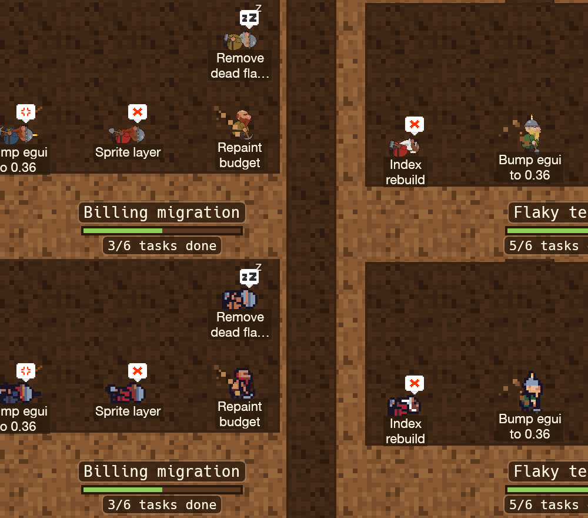

Also fixed after Karl's notes:
- The mining swing is overhead now, with both hands on the handle. It goes up behind the
  head, over the top and down in front; before, it swung underarm.
- The pickaxe head curves back towards the hands.

**Roles, parts and poses** (Karl: "more roles and more parts … and any other things you can
think of"; the front-facing King and Envoy were dropped as unnecessary complexity). The dwarf
module is now split into `mod.rs` (look, names, assembly), `pose.rs` and `parts.rs`.

- **Roles, by agent kind:**
  - **Miner** for workers and terminals;
  - **Foreman** for coordinators and attendants: older, cap, vest with a brass badge,
    lantern on a pole;
  - **Apprentice** for subagents: 80 % size, stubble or goatee, a helmet a size too big,
    a little lantern;
  - **Ravenmaster** for the Envoy: dark feathered hood, a raven on his shoulder, a brass
    ear trumpet;
  - **King** for the Queen.

  `Look::for_role(role, seed)`: faces and colours vary freely, and the role sets the kit.
- **Parts:**
  - hair: short, long, ponytail, braid;
  - beards: long, forked, bushy, short, braided, mutton chops, goatee, stubble;
  - brows: bushy, thin, wild;
  - noses: round, long, hooked (plus size);
  - hats: helmet, candle helmet, horned helmet, cap, hood, bandana, bald, crown;
  - clothes: tunic, leather apron, vest;
  - tools: pickaxe, hammer, shovel, lantern, ear trumpet, scepter;
  - extras: eyepatch, pipe, earring, scar.
- **Actions** (only work moves):
  - Still;
  - **Wait** (fists on his planted tool, chin up, glaring);
  - Study;
  - Mine;
  - **Build** (short chest-high blows);
  - Walk;
  - **Carry** and **Hold** (lugging a big gold nugget against his belly);
  - **Sleep** (on his back in a nightcap, eyes shut);
  - **KnockedOut** (on his back, eyes crossed).

  Lying dwarves put their tool away.
- **Farm mapping:**
  - waiting on Karl → Wait;
  - building → Build;
  - working coordinators and the Envoy → Study;
  - done → Carry or Hold (the crumb sprite is dropped for dwarves);
  - asleep → Sleep;
  - failed and falling → KnockedOut.
- **Names:** `dwarf::name(seed)` gives a stable dwarvish name ("Rurur Ironfoot") from
  invented syllables, avoiding Tolkien's. The lab shows it.

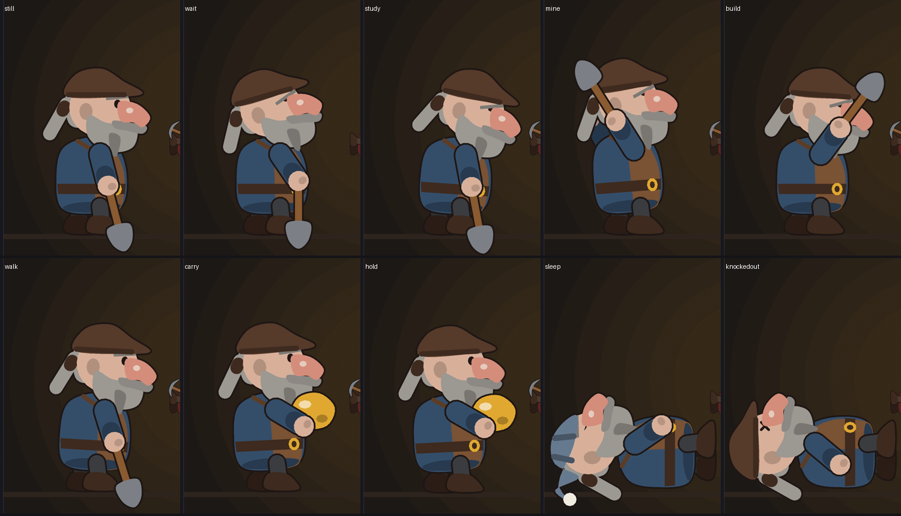
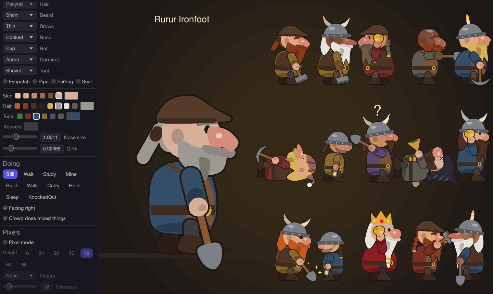
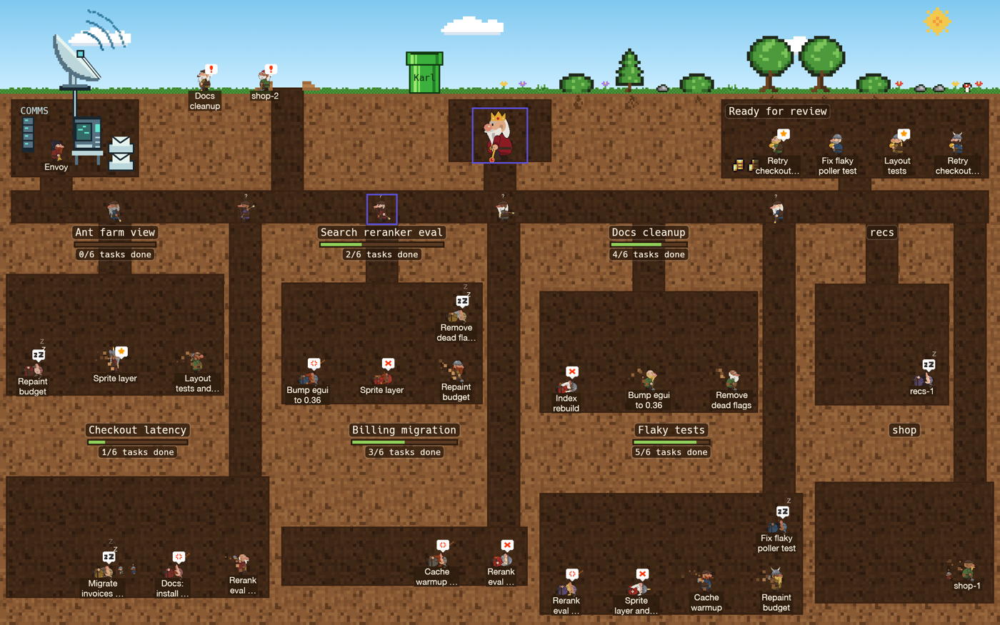

Next, if Karl likes the direction:
- showing each agent's dwarf name somewhere in the app (tooltip or details);
- a lighter farm backdrop, or a per-palette outline colour, where a palette's darkest
  colour swallows the outline;
- dwarf-specific overlays (a hard hat for builders, an ear trumpet for the Envoy).

## 1. What Myrstack ships today

### Bundled files (`assets/`, compiled in with `include_bytes!`)

| File | Size / format | Used for | Source | Licence |
| --- | --- | --- | --- | --- |
| `art/queen.svg` | 64×64 vector, rasterized up to 256 px | The Queen's avatar: graph hub node, top bar, Queen button, details header, chat header and chat empty state (`src/ui/art.rs`) | Ant and crown from Microsoft Fluent Emoji (Flat), on a honey hexagon drawn for Myrstack | MIT (Fluent parts); hexagon is Myrstack's own |
| `art/ant_cell.svg` | vector, shown 28–96 pt | "Connecting to Orca" empty state (`src/app/panes.rs`) and the empty review queue (`src/ui/review.rs`) | Fluent Emoji ant on a comb cell drawn for Myrstack | MIT (Fluent parts); cell is Myrstack's own |
| `art/anthill.svg` | vector | Sidebar empty state, "The colony is quiet" (`src/ui/sidebar.rs`) | Fluent Emoji ants on a mound drawn for Myrstack | MIT (Fluent parts); mound is Myrstack's own |
| `art/farm/ant_grey.png` | 16×32 PNG, two stacked 16×16 walk frames | Every ant in the ant farm. Recolored in code to Claude (amber), Codex (slate/teal) and plain (grey) coats (`src/ui/ant_farm/sprites.rs`) | "16x16 Ant Enemies" by ARoachIFoundOnMyPillow, OpenGameArt | CC0 |
| `art/farm/ant_red.png` | 16×32 PNG, two frames | Failed ants (drawn belly up) | same sheet set | CC0 |
| `art/farm/crown.png` | 16×16 PNG | The Queen's crown, carried item | "Gold treasure icons 16x16" by Bonsaiheldin, icon 9 | CC0 |
| `art/farm/coin.png` | 16×16 PNG | A crumb (one PR) carried to storage | same set, icon 2 | CC0 |
| `art/farm/coin_pile.png` | 16×16 PNG | One PR's crumbs on the storage pile | same set, icon 3 | CC0 |
| `art/farm/emote_exclamation.png` | 16×16 PNG | Speech bubble: needs input | Kenney "Emotes Pack", pixel style 1 | CC0 |
| `art/farm/emote_sleeps.png` | 16×16 PNG | Speech bubble: idle / asleep | Kenney | CC0 |
| `art/farm/emote_anger.png` | 16×16 PNG | Speech bubble: whipped / stalled | Kenney | CC0 |
| `art/farm/emote_cross.png` | 16×16 PNG | Speech bubble: failed | Kenney | CC0 |
| `art/farm/emote_star.png` | 16×16 PNG | Speech bubble: PR ready | Kenney | CC0 |
| `art/farm/emote_dots3.png` | 16×16 PNG | **Unused.** Bundled in the repo but no code loads it | Kenney | CC0 |
| `fonts/Phosphor-Bold.ttf` | icon font, 495 KB | Every UI icon: kind icons (crown, tree-structure, headset, hard-hat, terminal-window, robot), state glyphs (play, moon, !, hourglass, check, x) and toolbar icons (`src/ui/icons.rs`) | Phosphor Icons 2.1, bold | MIT |

Credits and licence texts are in [`assets/LICENSES.md`](../../assets/LICENSES.md).

### Other image files

- `packaging/Myrstack.icns`: the app icon, rendered by `scripts/make_icon.py`. It is Myrstack's own work.
- `docs/*.png`, `docs/visual-identity/*.png`: screenshots for docs and PRs. They are not shipped.
- `tests/fixtures/voice/*.wav`: a test fixture. It is not art.

### Art drawn in code (Myrstack's own, no licence question)

These are drawn in code, not loaded from files, but they belong to the look and would change
with a new theme:

- **Ground tiles** (`sprites.rs`): soil and tunnel tiles (32×32 generated noise, four shades
  each), a grass tile, the sky gradient (day and night palettes, `Palette`), stars.
- **Surface scenery** (`nature.rs`, character-map pixel art): tree, pine, bush, flowers
  (red, yellow, purple), grass tuft, rock, mushroom, cloud, moon, sun. Roots under plants.
- **Farm furniture** (`sprites.rs`, `comms.rs`): anthill mound, passages, the resting area's
  wooden bed with pillow and blanket, Karl's green warp pipe, the Envoy's dish/receiver and
  listening post with headphones, the incoming-mail tray.
- **Ant props and effects** (`sprites.rs`, `pops.rs`, `death.rs`, `envelope.rs`): the builder's hard
  hat and hammer, the whip's lash, flying dirt, snore "z", glow, sparkles, the Queen's call
  rings, state-change pops, envelopes and pings in flight.
- **Graph** (`src/ui/graph/shape.rs`): node shapes per kind (the Queen's hexagon and others),
  state fills and the indigo accent (`src/ui/theme.rs`, `ACCENT = #5a51e0`). The graph uses
  the Queen avatar texture and Phosphor glyphs.

## 2. The Paleccino pipeline

**What it is.** Paleccino lives at `~/repo/projects/paleccino` (`git@github.com:gylleus/paleccino.git`,
v0.2.0). It is the sprite pipeline pulled out of fitness-rpg into a standalone repo. Fitness-rpg
still runs its own copy in-tree (`image-generation/`, `uv run sprites …`). Paleccino is the
portable one, and the one to use for Myrstack.

**How it works.**

- CLI: `uv run paleccino --project <art>/sprites.toml <command>`. Python 3.12 and `uv`. The
  light CLI needs only numpy, pillow, scipy and scikit-image.
- `init <dir>`: creates `sprites.toml` and `palette.json`, with Jehkoba64 as the default or
  `--palette` for another. Each project owns its palette and art direction.
- `generate "<description>" --name id --out attempts/x`: runs fully locally. SDXL with a
  pixel-art LoRA draws a reference image, Wan 2.2 (5B by default) animates it, BiRefNet and
  SAM2 cut out the background, and the result is exported at a fixed palette.
  `--backend reference` produces a static sprite only. Useful options: `--animation
  name=motion`, `--once`, `--reference img.png` (animate an approved design), `--facing`,
  `--sprite-size`, `--frames`, `--seed`.
- `plan` → `register` → `recipe` → `import-sheets`: the authored-sheet workflow. A TOML
  definition (style, lighting, one entry per asset with `visual_description`, size and
  per-animation frames and timing) becomes exact prompts. You feed those to any image
  generator or artist, then import the resulting sheets.
- `map` / `check` / `verify`: maps colors to the palette (CIEDE2000, no dithering), rejects
  off-palette pixels, and replays archived exports.
- **Output:** transparent PNG frames and atlases at a fixed palette, a `manifest.json` with
  timing, a GIF preview and an offline `review.html`. Every attempt keeps its prompts, seeds,
  originals and hashes.
- **Dependencies and credentials:** no API keys, since inference is local. The model cache is
  `~/.cache/paleccino` (`PALECCINO_HOME` to move it). It needs about 8 GiB for `reference`,
  25 GiB for `wan5b` and 46 GiB or more for `wan14b`. It runs on Apple Silicon (MPS) or
  Linux/CUDA.

**Verdict: works on this Mac, end to end.** The art still needs review: the models give good
raw material, not finished sprites.

| Check (2026-10-11, this Mac) | Result |
| --- | --- |
| `paleccino doctor` | Runtime installed, MPS available, all wan5b models present (25 GiB already cached), nothing missing |
| `init` a Myrstack art project | Works |
| `plan` a 16 px ant with a 2-frame walk | Works, writes the exact prompt per action |
| `map` + `check` on today's `crown.png` | Works. The original fails the check (5 off-palette colors), the mapped copy passes |
| `generate --backend reference`, a dwarf miner | Works. SDXL reference in 34 s, then cutout and a fixed-palette export. A first try was refused for disk space (3.9 GiB free, 4 GiB reserve hard-coded); Karl freed space and the rerun passed |
| Same reference exported at 32, 48 and 64 px | Works. 32 px is muddy, 48 px reads as a dwarf, 64 px is clearly better (see below) |

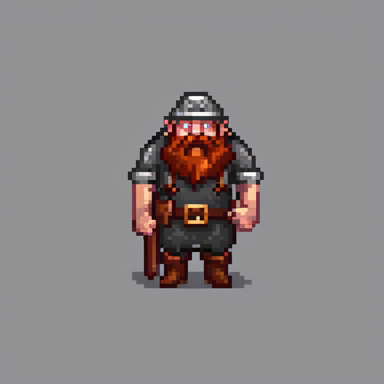
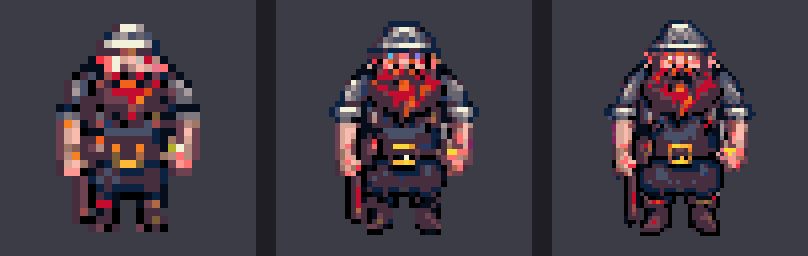

What the test showed:

- **The reference stage is good.** It produced a clean, characterful pixel-art dwarf.
- **The prompt isn't followed literally.** It faced the front although I asked for a side
  view, and it dropped the pickaxe and candle lamp. Paleccino's own validation notes the same
  facing problem. Plan to generate a few seeds per asset and pick, or redraw a reference and
  feed it back with `--reference`.
- **Resolution matters more than anything else.** Downsampling a 768 px reference to 32 px
  loses the face and beard. 48 px is the smallest size that keeps the character.
- **The default palette hurts.** Jehkoba64 turned the red beard muddy. A palette chosen for
  the theme (warm golds and ember, cool stone, a few skin and beard ramps) should fix most
  of that.
- **Animation:** see 2b. Wan's motion was unusable, and the sheet route replaced it.

### 2b. Animation: why Wan failed, and the route that works

Paleccino's `generate` animates with the local **Wan 2.2 5B** video model. For Myrstack's
miner (seed-41 profile reference, `mine` and `think`, 33 frames at 512 px, about 7–10 min a
clip) it was **unusable**. The model zoomed in, invented rock and coloured junk, and lost
the dwarf's identity mid-swing. The raw frames show it, so the background removal isn't to
blame.

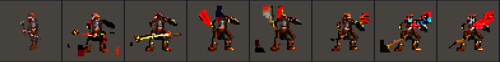

**fitness-rpg never shipped Wan animation.** Its provenance records about 1,300 assets made
with `"backend": "built-in imagegen"` / `"tool": "image_gen.imagegen"`. That's Codex's
built-in image tool, a hosted OpenAI image model. It draws **one sheet of discrete poses
per action** from an identity reference (and, there, a motion storyboard), and `import-sheets`
cuts the cells on the CPU. Wan was a research track (`image-generation/pixel-animation-14b/`):
its best result was the 14B model with a pixel adapter on an RTX 3090, for gentle breathing
motion, and it still needed cleanup.

**The route Myrstack uses, tested 2026-10-11/12:**

1. `paleccino plan --definition hold-v1.toml` writes one exact prompt per action
   ([`prompts/hold-v1.toml`](prompts/hold-v1.toml)). I drop the palette paragraph (palettes
   are applied at runtime) and ask for a flat grey background.
2. [`tools/imagegen.sh`](tools/imagegen.sh) runs one headless `codex exec` call per image,
   with the identity reference attached (`-i`). It copies the untouched PNG out. About
   1–2 minutes per image, on Karl's Codex quota.
3. **Reference first:** one still per character
   ([`prompts/miner-ref-v2.txt`](prompts/miner-ref-v2.txt)), then one sheet per action
   from that reference (`miner-mine.txt`, 8 poses; `miner-think.txt`, 6; `king-command.txt`,
   6, played once). They come back consistent: same face, kit and proportions in every
   pose.
4. **Import and downscale.** `register` → `recipe` → `import-sheets` works with two quirks:
   - The 8-pose sheets came back 1774×887, so they're trimmed by 1–2 px of background to
     divide into the grid.
   - Paleccino's sheet import only has nearest-neighbour scaling, which speckles a painted
     sheet shrunk about 9× and leaves a grey fringe.

   [`tools/downscale.py`](tools/downscale.py) instead keys out the grey at full size,
   erodes the edge 2 px, uses one shared crop for all poses, and area-averages to 48/64 px
   with binary alpha. That's clean. Long term, this belongs in Paleccino as a `box` resample
   option.

Karl's notes on the image_gen rounds:

- **Too tall.** The first dwarves were about 4½ heads tall. The proportions line that fixed
  it, now in every prompt: *"a proper fantasy dwarf, NOT a short human: about 2.5–3 heads
  tall, nearly as wide as tall, oversized head and beard, barrel chest, very short stubby
  legs, oversized hands and boots, low squat centre of gravity."*

  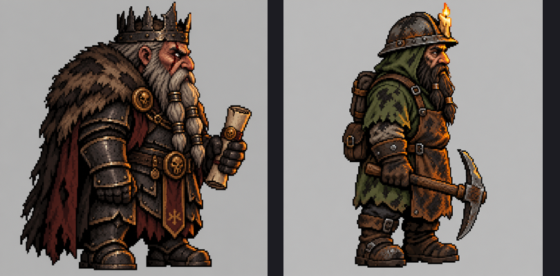
  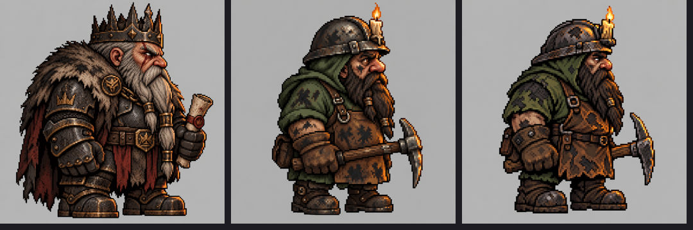

- **The King was too kind.** He's now a scowling taskmaster: broken nose, a scarred eye.
- **The King and the Envoy face the camera.** They don't walk around.
- **No scroll; a scepter, and much richer.** "We are getting rich here after all." He now has
  a gem-set gold crown, gold-inlaid plate, a ruby chain, rings, and a ruby scepter.

  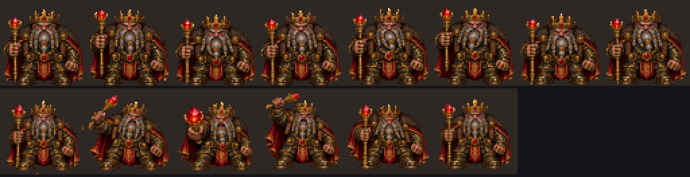

  The image model doesn't hold scale exactly between poses: the idle shifts size and
  position slightly. Fix it in the recipe with per-pose ground contacts or regions, or
  regenerate the sheet.
- **Not realism: comic dark fantasy.** "Their heads or weapons can grow in size, or wiggle."
  Round 3 redrew both characters with the cartoon style block; the first sheet shows the
  difference.

  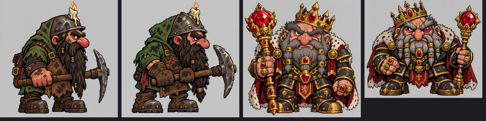
  

- **No idle animations.** Idle holds a still; thinking gets a working animation.
- **A network drop stalls Codex.** It waits "for network" indefinitely, so batch runs need
  a per-call time limit.
- **Headless Codex needs `< /dev/null`.** Run in the background without it, `codex exec`
  waits forever on stdin. [`tools/imagegen.sh`](tools/imagegen.sh) closes it.

**Fit for Myrstack, and what reuse needs:**

- **Reuse as an external tool, not a copy.** Add a Myrstack art project in the repo, say
  `art/` (`sprites.toml`, `palette.json`, the definitions TOML, `attempts/`, `asset-library/`),
  and run Paleccino from its own checkout with `--project art/sprites.toml`. Commit only the
  definitions, palette, chosen exports and provenance. Nothing needs copying, and Myrstack's
  Rust build gains no Python dependency. A `just art …` recipe can wrap the call.
- **Pixel art only.** Paleccino exports fixed-palette pixel PNGs. That suits the ant farm
  directly. The UI illustrations (Queen avatar, ant cell, anthill) are smooth SVGs today.
  Replacing them makes those pixel art too, loaded as PNGs with nearest filtering instead of
  rasterized SVG (a small change in `src/ui/art.rs`). Whether the UI should go pixel is part
  of the theme decision.
- **Bigger sprites.** The models draw at 512–768 px and downsample. Today's 16 px farm cells
  are too small for generated art; the test above puts the floor at 48 px. The farm's layout is
  in farm texels (`px` per texel), so bigger sprites mean adjusting its scale constants and
  the sizes of the drawn props.
- **Short loops.** Wan makes 33-frame videos. Myrstack's ants use 2-frame walks. Use
  `frame_stride`/`--frames`, or the authored-sheet path, for short loops. Recoloring by coat
  (Claude/Codex/plain) keeps working if the exported ant uses a small, known set of palette
  colors.
- **Phosphor icons stay.** They are functional glyphs at text size, not sprites.

## 3. The dwarf hold: the fleet as a mine

The ant farm becomes a cutaway of a dwarven mine under a mountainside. Each fleet concept
gets a dwarf counterpart. The farm's layout and behaviour stay as they are (same places,
same state → place rules); only what is drawn changes.

| Fleet concept | Ant farm today | Dwarf hold |
| --- | --- | --- |
| The Queen (the fleet hub) | Crowned ant in the Queen's chamber | **The King under the Mountain**, a grumpy taskmaster overlord in the **throne hall**, facing the camera |
| Coordinator / attendant | Ant at a tunnel's mouth | **Foreman** with a lantern and a scroll of plans, at the **shaft head** |
| Worker / terminal | Ant digging in the chamber | **Miner** with a pickaxe at the **ore face** at the end of the shaft |
| Worker editing or building | Hard hat and hammer overlay | Miner **hammering timber supports** with a mallet, sparks flying |
| Subagent (trails its parent) | Small faded ant | **Apprentice**: a young, short-bearded dwarf carrying a lantern behind their elder |
| The Envoy (outside world) | Dish on the surface, listening post with headphones | **Ravenmaster**, facing the camera: a raven roost on the surface, and a desk underground with a brass **speaking tube** and ear trumpet |
| Claude / Codex / unknown agent | Amber / slate-teal / grey ant coat | **Livery colour** of hood and tunic: amber-ochre / slate with teal trim / plain grey |
| Needs input (waiting on Karl) | Ants queue at the landing on the surface | Dwarves queue at the **mine entrance** on the mountainside |
| Karl's messages | Pop out of a green warp pipe | Pop out of a brass **message tube** rising from the rock, as sealed scrolls |
| Done / PR ready | Ant carries a crumb to the storage pile | Dwarf carries a **gold nugget** to the **treasury**, where each PR is a **treasure heap** |
| Idle / stalled | Ant asleep, "Zz" | Dwarf **dozing** against the rock, sitting on a crate |
| The whip (nudge a stalled agent) | A lash pokes the ant | A **pebble bonks the helmet**: a small stone arcs in, "tink", the dwarf jolts awake |
| Failed | Red ant, belly up | Dwarf **knocked flat** on their back, helmet off, red livery, cross bubble |
| Leaving the fleet | Ant flips and falls | The knocked-flat dwarf falls and fades (same motion) |
| Parked (resting area) | Ants in wooden beds | Dwarves in **bunks** with straw mattresses, wool blankets and nightcaps |
| Messages between agents | Envelopes in flight | **Sealed scrolls** in flight |
| Tool calls | Beams through the soil | **Glowing rune lines** through the rock |
| Gallery and tunnels | Dug passages in soil | A **haulage way** with mine-cart rails, shafts shored with **timber**, lit by **wall torches** |
| Surface | Meadow: trees, flowers, mushrooms | **Mountainside**: pines, boulders, heather, alpine flowers, distant peaks |

## 4. Resources needed

Shared art direction for every generated asset:

- **Style:** **dark-fantasy cartoon with a comic-book feel, not realism.** Caricatured
  proportions: huge heads, oversized hands, beards, boots and weapons. Bold simple shapes,
  thick ink outlines, flat colour with hard cel shadows, little texture noise. Grim mood
  (soot, dents, scars, muted iron and earth with punchy gold, crimson and ember). The
  shared style block is [`prompts/v3/style.txt`](prompts/v3/style.txt).
- **Motion:** cartoon animation: anticipation, squash and stretch, overshoot; heads, beards
  and tools may swell and wobble for emphasis.
- **No idle animations, ever** (they distract). An agent that is idle or done holds a
  **still pose** (one frame). Motion means work: the *working* animation plays while an
  agent is thinking about its prompt or task, and the action animation (mining, building)
  while it uses tools.
- **Lighting:** harsh low torchlight, deep shadows, three stepped shades per material. Gold
  and gems get a bright specular pixel.
- **Dwarves are dwarves:** about 2.5–3 heads tall and nearly as wide, oversized head and
  beard, barrel chest, stubby legs, big hands and boots. Every character prompt carries the
  proportions line from 2b.
- **View:** strict right-facing side profile for everyone who moves; the code mirrors for
  left. **The King and the Envoy face the camera**, since they stay at their posts.
- **Palette:** none at generation. Assets are kept in their original colours and the app
  applies a swappable palette at runtime (see 4j).
- **Format:** transparent PNG frames and atlases from Paleccino, unless noted.

**Scale.** One farm texel today becomes 3 texels, so a 16 px ant cell becomes a **48×48**
actor cell, and every prop and tile below is sized at that density. Sizes are given in final
pixels.

**Livery recoloring.** Every dwarf's hood and tunic are generated in one **key colour** that
nothing else on a dwarf uses (a saturated green). At load the app swaps that hue for the
agent's livery (Claude amber, Codex slate with teal, plain grey, failed red) and keeps each
pixel's lightness, so the shading survives. One sprite then serves every agent. The ants do
something similar today with an exact six-colour ramp, but exact ramps don't survive
unpaletted originals; a hue key does. This has not been tested yet: it's the first thing
to try with the key-colour miner.

### 4a. Characters (48×48 cells unless noted)

Every character is drawn in the cartoon style (4, top) from one approved identity
reference, with one Codex image_gen sheet per animation (2b). Each character has:

- **`still`:** one frame, the reference pose cut to size. Shown when the agent is idle,
  done or parked. **No idle loops.**
- **`work`:** a loop that plays while the agent is thinking about its prompt or task
  (`detect.rs` can tell thinking apart from tool use).
- **Action loops** for tool use, and one-shots where noted.

Frame counts are targets (6–8 per loop); durations are tuned in code.

1. **`miner`**: workers and loose terminals, most of the crowd. Right-facing profile.
   *Visual:* a squat cartoon dwarf, about 2 heads tall: enormous head under a dented iron
   helmet with a guttering candle stuck on top, a giant bulbous nose, huge brows, a massive
   dark beard to the knees, a soot-blackened key-colour green hood and tunic (livery), a
   scorched apron, tiny legs in huge boots, an oversized chipped pickaxe
   ([`prompts/v3/miner-ref.txt`](prompts/v3/miner-ref.txt)).
   *Animations:*
   - `study` 6, the work loop: squints at the rock face, taps it and listens, scratches
     under the helmet.
   - `mine` 8, tool use: wind-up, smear, squash on impact with sparks. **Tested; looks
     right.**
   - `build` 8, editing or building: hammers a timber prop, wobbling.
   - `walk` 8.
   - `carry` 8: hauls a nugget overhead.
   - `knocked_out` 1: flat on the back, helmet off.
   - Stills: `wait` (arms crossed, tapping a boot, glaring up at the surface; needs input)
     and `doze` (slumped on a crate, beard over his face; idle, with the "Zz" bubble
     carrying the state).
2. **`foreman`**: coordinators and attendants. Profile. *Visual:* an older cartoon
   dwarf with a grey braided beard, a peaked leather cap, a lantern on a pole and a rolled
   plan under one arm, livery tunic with a brass badge. *Animations:* `work` 6 (unrolls the
   plan, jabs at it, shouts down the shaft); `walk` 8; `carry` 8; `knocked_out` 1; stills
   `still`, `wait` and `doze`.
3. **`apprentice`**: subagents. *Size:* 36×36 inside a 48 cell. Profile. *Visual:* a
   young cartoon dwarf with a stubbly beard, an oversized helmet over his eyes and a small
   lantern; livery as their elder. *Animations:* `walk` 8 (scurrying); `work` 6 (holds
   the lantern up for the elder, peering); `still`.
4. **`king`**: the Queen node. *Size:* 64×64. **Faces the camera.** *Visual:* a squat,
   greedy, grumpy cartoon dwarf king grown obscenely rich: enormous scowling head, a giant
   crooked nose, a scarred squinting eye, furious brows, a beard braided with fat gold rings,
   an oversized askew spiked gold crown crammed with rubies, black plate with gold trim, a
   fur and crimson mantle, and a comically huge gold **scepter** with a glowing ruby
   ([`prompts/v3/king-ref.txt`](prompts/v3/king-ref.txt)). His crown is part of the
   sprite, so the separate crown item is no longer needed on him.
   *Animations:*
   - `still`: glaring, scepter planted.
   - `work` 6, while the Queen is busy on a chat turn: counts gold coins and bites one
     suspiciously.
   - `command` 6, played once: swells up, thrusts the scepter, bellows; the Queen spawns
     a session and a new dwarf walks in from the mine entrance.
   - `call`: the code draws the call rings over `still`.
5. **`ravenmaster`**: the Envoy. **Faces the camera.** *Visual:* a squat, hunched
   cartoon dwarf in a ragged feathered cloak, a raven on one shoulder, a dented brass ear
   trumpet bigger than his head. *Animations:* `still`; `work` 6 (trumpet to the ear,
   eyes bulging, the raven leaning in); `receive`, played once (the raven flaps off with a
   scroll).
6. **`raven`**: the Envoy's messenger on the surface. *Size:* 24×24. *Visual:* a scruffy
   cartoon raven with a scroll tied to one leg. *Animations:* `still` (perched); `fly` 6,
   played only while carrying a message.

### 4b. Treasure and items

7. **`gold_nugget`**: a crumb, one PR's haul being carried. *Size:* 24×24. *Visual:* a
   lumpy, bright gold nugget with a white glint.
8. **`treasure_heap`**: one PR on the treasury floor. *Size:* 48×32. *Visual:* a small heap
   of gold nuggets and coins with one cut gem on top. Variants: ruby, emerald and sapphire
   gems, so neighbouring heaps differ.
9. **`treasure_chest`** (treasury dressing): *Size:* 48×40. *Visual:* an open iron-bound
   oak chest spilling gold.
10. **`scroll`**: a message in flight, and Karl's messages from the tube. *Size:* 18×12.
    *Visual:* a rolled parchment tied with string and a red wax seal.
11. **`pebble`**: the whip. *Size:* 9×9, 2 frames. *Visual:* a small grey stone; frame two
    adds a white "tink" spark.

### 4c. Status bubbles (36×36, drawn over a dwarf's head)

All share one frame: a parchment-cream speech bubble with a dark ink outline and a tail at the
bottom left, the mark centred.

12. **`bubble_alert`**: needs input. *Mark:* a bold "!" in ember orange.
13. **`bubble_sleep`**: idle or dozing. *Mark:* "Zz" in cool blue.
14. **`bubble_whip`**: stalled. *Mark:* a red anger puff.
15. **`bubble_failed`**: failed. *Mark:* a red "×".
16. **`bubble_pr`**: PR ready. *Mark:* a faceted gold gem with a sparkle.
17. **`bubble_working`** (optional): *Mark:* three dots.

### 4d. Set pieces: places in the hold

18. **`mine_entrance`**: the landing, where dwarves wait for Karl. *Size:* about 96×72.
    *Visual:* a timber-framed portal cut into the rocky hillside, a lantern on a hook, a
    small wooden sign with crossed pickaxes. Dwarves stand in line beside it.
19. **`message_tube`**: replaces Karl's green pipe. *Size:* 48×72, built as three parts:
    a flared brass bell mouth on top, a body segment that tiles vertically (it stretches while
    a message pops out), and a riveted base flange. A blank brass plate on the body holds the
    code-drawn label.
20. **`throne`**: the throne hall. *Size:* 64×80. *Visual:* a massive carved stone throne,
    gold inlay and a red cushion, on a two-step dais.
21. **`banner`**: throne-hall dressing. *Size:* 24×64. *Visual:* a long red and gold
    banner with a crown-and-pickaxe emblem, hanging from a pole.
22. **`brazier`**: throne hall and treasury. *Size:* 24×36, 4 frames. *Visual:* an iron
    bowl on three legs with flickering coals and flame.
23. **`shaft_head`**: the mouth of each tunnel, where the foreman stands. *Size:* 48×48.
    *Visual:* a timber headframe over the shaft with a pulley and a hanging lantern.
24. **`ore_face`**: the rock face at each chamber's end, where miners dig. *Size:* 48×96,
    tiles vertically. *Visual:* rough rock with glittering gold veins and a few embedded gems.
25. **`timber_support`**: tunnel dressing, repeated. *Size:* 24×72. *Visual:* two wooden
    posts and a crossbeam with iron brackets.
26. **`wall_torch`**: lights the haulage way. *Size:* 15×30, 4 frames. *Visual:* an iron
    sconce with a burning torch.
27. **`mine_cart`**: gallery dressing, optional animated. *Size:* 48×36. *Visual:* a small
    iron cart on four wheels, heaped with ore.
28. **`bunk`**: the resting area. *Size:* 72×48. *Visual:* a two-tier wooden bunk with straw
    mattresses and pillows. Blankets go over the sleepers separately.
29. **`blanket`**: *Size:* 36×18. *Visual:* a red and green plaid wool blanket.
30. **`nightcap`**: a 2-frame overlay for sleepers. *Visual:* a floppy striped cap with a
    pom-pom.
31. **`raven_roost`**: the Envoy's surface receiver. *Size:* 48×64. *Visual:* a weathered
    post with a crossbar and a small birdhouse. Variants: `normal` (raven perched),
    `stopped` (empty, greyed), `receiving` (raven landing, gold glint).
32. **`speaking_desk`**: the Envoy's underground post. *Size:* 48×36. *Visual:* a small
    stone desk with a coiled brass speaking tube rising into the rock, and an inkpot.
33. **`scroll_rack`**: the incoming-mail tray. *Size:* 36×24. *Visual:* wooden pigeonholes
    with rolled scrolls; the code draws the count badge.

### 4e. Tiles (seamless, 48×48)

34. **`rock_tile`**: the body of the mountain. Grey-brown granite with faint strata lines,
    scattered pebbles, four tones; quiet enough to sit behind the actors.
35. **`deep_rock_tile`**: lower levels. The same rock, darker and cooler.
36. **`tunnel_tile`**: dug passages and chambers. Darker worked stone, smoother, with chisel
    marks, so passages read as hollow.
37. **`rail_strip`**: the haulage way floor. A horizontal strip, 48×12: wooden sleepers and
    two iron rails.
38. **`vein_gold`, `vein_gem`**: 48×48 accents sprinkled into `rock_tile`. Thin gold
    veins in one, small embedded crystals in the other.
39. **`surface_edge`**: the top of the mountain. A horizontal strip, 48×24: heather and
    short grass over rock, with a few loose stones overhanging.

### 4f. Surface and cave scenery

40. **`pine`**: 54×78, rooted. A tall mountain pine with tiered branches.
41. **`spruce`**: 42×66, rooted. A narrower dark spruce.
42. **`boulder`**: 48×33. A big mossy boulder.
43. **`rock_small`**: 24×15. A small grey stone.
44. **`heather`**: 21×15. A clump of purple heather.
45. **`flower_edelweiss` / `flower_gentian` / `flower_alpine_rose`**: 15×21 each. White,
    deep blue and pink alpine flowers.
46. **`mushroom`**: 18×18. A red-capped mushroom with white spots.
47. **`cloud`**: 120×36. A flat-bottomed cloud, white with a pale-blue underside.
48. **`moon`**: 48×48. A pale full moon with craters.
49. **`sun`**: 54×54. A warm yellow sun with short rays.
50. **`peaks`**: a wide backdrop strip, about 480×96, tileable. Distant snow-capped peaks
    in hazy blue, drawn behind the surface.
51. **`cave_crystals`**: underground dressing. *Size:* 24×24. *Visual:* a cluster of glowing
    blue-violet crystals growing from the rock.
52. **`glow_mushrooms`**: underground dressing. *Size:* 18×15. *Visual:* small pale
    mushrooms with a faint teal glow.
53. **`stalactite`**: chamber ceilings. *Size:* 12×30. *Visual:* a dripping rock spike.

### 4g. UI illustrations (pixel art, replacing the SVGs)

Each is generated at its largest size and also exported at the listed smaller sizes, so it
is drawn at a whole-pixel scale. `src/ui/art.rs` would load PNGs with nearest filtering.

54. **`king_avatar`**: replaces `queen.svg` everywhere the Queen appears (graph hub, top
    bar, Queen button, chat). *Sizes:* 128, 64, 32 and 16 px. *Visual:* a front-facing
    portrait of the King: white braided beard, gold crown with a red gem, framed in a
    carved stone hexagon with a gold rim (the hexagon keeps the graph node's shape).
55. **`empty_connecting`**: "Connecting to Orca". *Size:* 96×96. *Visual:* a dwarf holding
    up a lantern, peering down a dark tunnel.
56. **`empty_quiet`**: "The hold is quiet" (sidebar, no agents). *Size:* 128×96.
    *Visual:* the mine entrance at night, an empty cart parked on the rails, one lantern
    glowing, stars above.
57. **`empty_review`**: empty review queue. *Size:* 48×48. *Visual:* a closed treasure
    chest with a small padlock.
58. **`app_icon`**: replaces `make_icon.py`'s output. *Size:* a 256 px pixel master
    scaled to 1024 for the icns. *Visual:* two crossed pickaxes behind a gold-rimmed stone
    hexagon holding a glowing gem.

### 4h. Not from Paleccino (code changes, after approval)

- **Effects stay code-drawn, recoloured to the theme:**
  - glow → warm torchlight
  - sparkles → gold glints
  - the Queen's call rings → the King's horn rings
  - state-change pops
  - dirt clods → rock chips with sparks
  - snore "z", stars, and the day and night sky
- **UI theme** (`src/ui/theme.rs`): the indigo accent (`#5a51e0`) becomes forge gold or
  ember on dark basalt panels. Graph node colours follow it.
- **Phosphor icons stay.** Check the set for pickaxe, lantern or shovel glyphs that fit the
  kinds better.
- **Farm scale:** the code moves to 48 px cells, and walks go from 2 to 4 frames.
- **Words:** labels and empty-state copy ("colony", "ants") change to the hold's.
- **The name:** Myrstack is Swedish for anthill, which no longer fits. Renaming is Karl's call
  and isn't part of this work.

### 4i. Side view: getting the dwarves to face sideways

Karl's first note: the test dwarf looks at the camera. SDXL with the pixel-art LoRA leans
heavily towards front and three-quarter views, and "side profile facing right" in Paleccino's
prompt template isn't enough on its own.

- **Sweep 1, plain prompt** ("seen strictly from the side in profile" in the description,
  front views in the negative): 0 of 6 seeds in profile.
  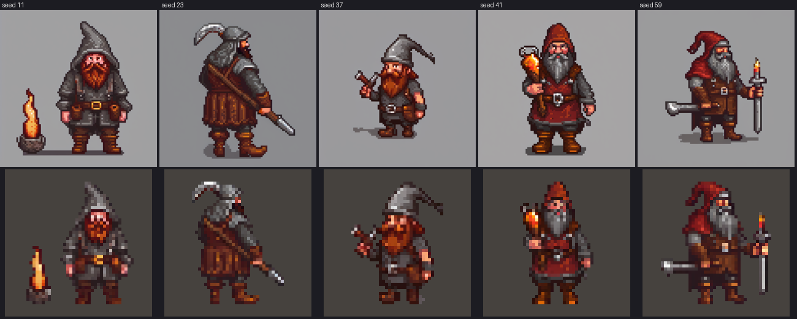
- **Sweep 2, profile prompt.** I borrowed fitness-rpg's `view = "profile"` wording: the
  description *starts* with "sprite in strict right-facing side profile. Orthographic
  90-degree side view. Head and body point toward the right edge together. Only the near
  side is visible…". The negative *starts* with the rejected views ("frontal view, facing
  camera, three-quarter view …"). The appearance stays short, so everything fits in one CLIP
  chunk. Result: 2 of 6 seeds in true profile (37 and 41), one close (73). The project
  settings and scripts are in [`prompts/`](prompts/).
  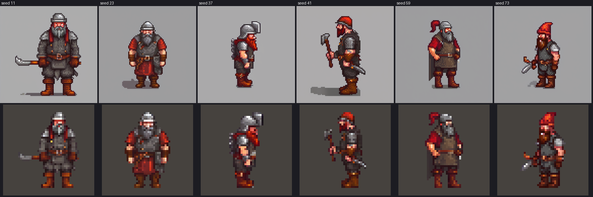

**Update:** Codex's image model holds a profile far better than SDXL. Both image_gen miner
references and all 14 sheet poses came back in profile at the first attempt. The SDXL
findings above matter only if Paleccino's local reference stage is used.

**For production with SDXL (superseded by image_gen for now):**

- Generate 6–8 seeds per dwarf with the profile prompt and keep the profiles. At about
  2 minutes a seed that's cheap.
- Animate only from an approved profile reference (`--reference`). The animation prompt
  repeats the facing.
- **To make it reliable,** port fitness-rpg's `--guide-image` / `--guide-strength`
  (image-to-image from a side-view silhouette) and `view = "profile"` into Paleccino.
  That changes Paleccino, not Myrstack, so it's Karl's call. With a guide, every seed comes
  out in profile, and dwarves of one role share a stance, which helps a big roster look
  consistent.

### 4j. Palettes, swappable at runtime

**Generation doesn't need the palette.** Paleccino applies the palette only at its last
export step. It already saves an unpaletted `original-colors.png` with the same size, crop
and frames as the paletted export. The pixel look comes from the downsample to 48 px, not
from the palette: the test dwarf has 743 colours unpaletted and still reads as pixel art.
The palette adds cohesion and mood.

So Myrstack ships the original-colour atlases and applies the palette itself:

- **At texture load, not in a shader.** egui has no simple hook for a custom fragment
  shader; a `PaintCallback` with glow or wgpu would work but costs far more code. Recoloring
  on the CPU when a texture is built is enough: each sprite has a few hundred distinct
  colours. Build a per-palette lookup from each distinct colour to its nearest palette
  colour (CIEDE2000, the same metric as Paleccino's `map_to_palette`), then rewrite the
  pixels. Switching palettes rebuilds the textures, which should take well under a second.
  The farm already recolors its ants at load (`sprites.rs`, `recolor`), so this extends an
  existing pattern.
- **Any palette works.** A palette is just a list of hex colours, such as a Lospec JSON
  file, with no fixed size or ordering. "None" shows the originals.
- **Order at load:** livery recolor (4) → palette mapping → texture. The livery hue swap runs
  on the originals, so every palette sees the same liveried dwarf.
- **Code-drawn art follows too.** Tiles, effects and sky colours go through the same nearest-
  colour mapping, so the whole farm changes together. The UI theme accent can take its
  colour from the palette as well.
- **Settings:** a palette picker in Settings, with a few bundled palettes and an option to
  add a Lospec JSON file.

Prototype: the same 48 px dwarf mapped to 15 Lospec palettes with Paleccino's own mapper
([`tools/palette_grid.py`](tools/palette_grid.py)). This is exactly what the app would do at
load time.

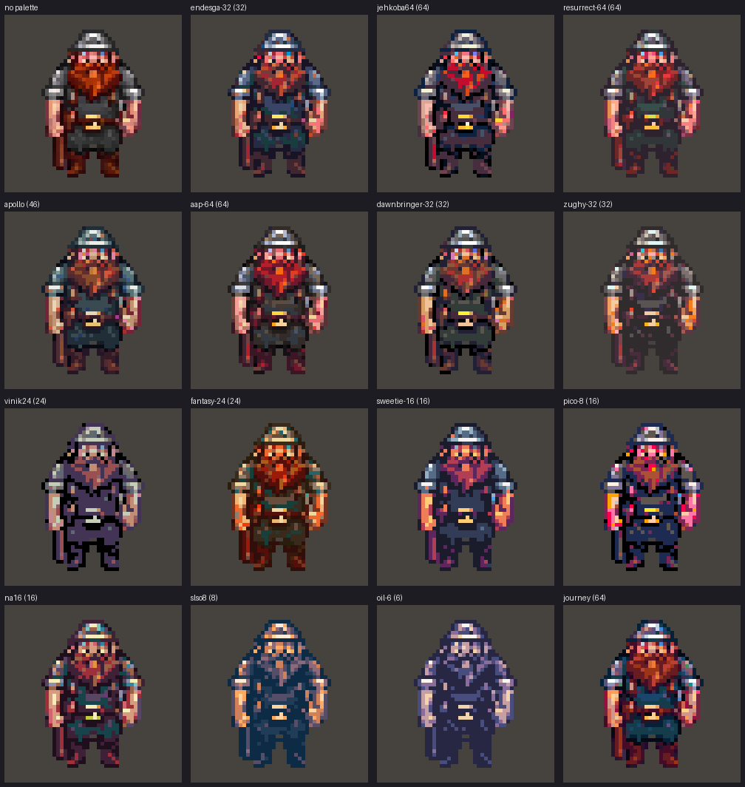

### 4k. Variety: a roster built to grow

Karl wants hundreds of different dwarves eventually. For now: a handful while the look
settles, built so more can be added endlessly.

- **One TOML file per dwarf** under `art/roster/`: role (miner, foreman, apprentice), build,
  beard colour and style, headgear, tool, accessories, and the key-colour livery. A small
  script turns a file into a Paleccino `generate` call: a reference, then the role's standard
  animation set with `--reference`, so every action keeps the same dwarf. Adding a dwarf
  means adding a file and running the script.
- **Trait tables for bulk:** later, a generator can combine traits (6 beards × 5 hats × 6
  tools × 3 builds …) into roster files, keeping only the ones that pass review.
- **Shipped as data, not code.** Each dwarf exports an atlas plus a manifest entry (role,
  animations, frames, timing). The app finds dwarves through one manifest, not one
  `include_bytes!` per file. Rough sizes: a 48 px dwarf with about 40 frames is about
  20–40 KB of PNG, so 300 dwarves come to about 10 MB, which can still be embedded.
  Textures are built only for dwarves on screen.
- **A dwarf per agent:** the app picks a dwarf from the role's pool by a stable hash of the
  agent id, so an agent keeps the same dwarf across polls and launches.
- **Review gate:** a generated dwarf joins the roster only after a look at its review page.
  Generated motion drifts and masks fail now and then.

## 5. Decisions

Settled with Karl (2026-10-11/12):

- Theme: dwarves underground, mining for gold and treasure; grim and gritty.
- 48 px actor cells (the King 64 px).
- Proper dwarf proportions.
- Miners in profile; the King and the Envoy face the camera.
- Many animations: mining, thinking, the King idle, the King ordering a new dwarf.
- Palettes swappable at runtime; Paleccino generates without one.
- Room for hundreds of dwarves later, a few for now.
- Codex image_gen is allowed for generation.

Still open:

1. **The concept mapping in section 3** for the remaining roles: foreman, apprentice,
   ravenmaster.
2. **The whip.** A pebble bonking the helmet is my suggestion. Alternatives: the foreman
   ringing a hand bell, or a splash from a water bucket.
3. **Karl's pipe.** A brass message tube is my suggestion. Alternatives: a mine-lift cage
   that comes down, or a well with a bucket.
4. **UI illustrations as pixel art** (King avatar, empty states, app icon), or smooth vector?
5. **Which palettes to bundle** for the first version of the picker (see 4j).
6. **Next batch.** I'd suggest finishing the cast first:
   - the miner's `walk`, `carry`, `build`, `knocked_out` and the `wait` and `doze` stills;
   - the King's `still` (his `work` and `command` are done);
   - the foreman, apprentice and ravenmaster;
   - two or three more miner variants, to test the roster.

   Then the code: palette mapping at load, the dwarf manifest, 48 px farm cells. Treasure,
   bubbles, tiles and set pieces come after.
